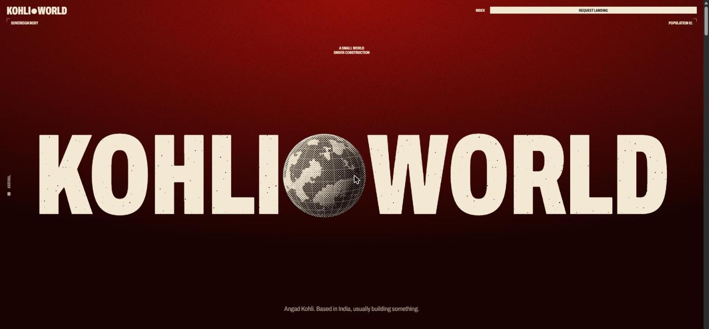
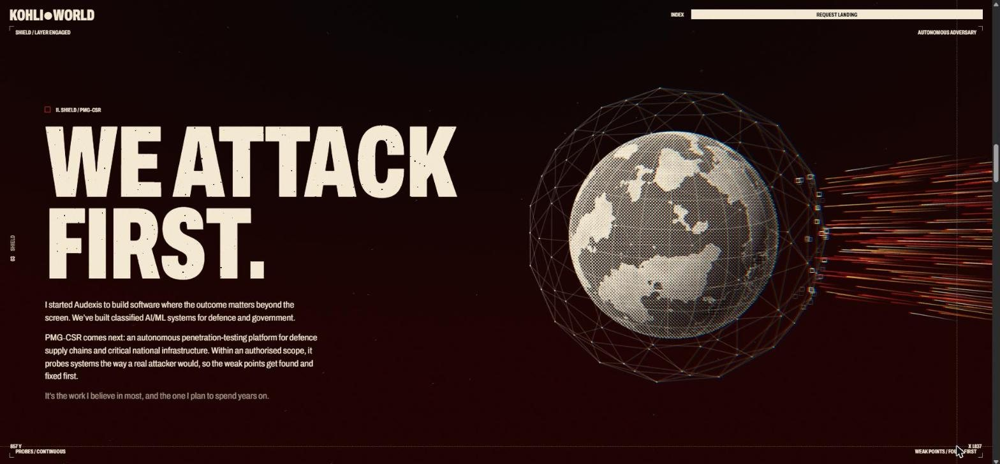
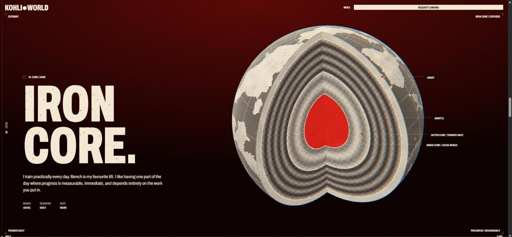
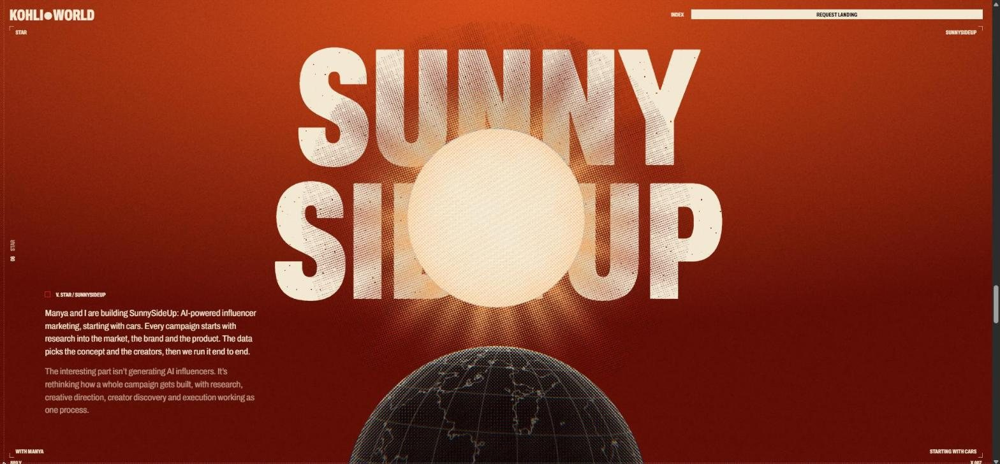
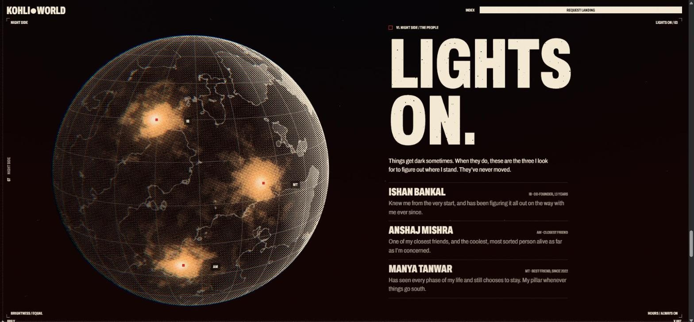

# KOHLI●WORLD

**A personal site built as one planet.** The dot in the domain is the world, and scrolling flies one camera around it: past the shield, through a cutaway core, out to the moon and the sun, and round to the night side.

Live at **[kohli.world](https://kohli.world)**.



| | |
|---|---|
|  |  |
|  |  |

No framework, no build step, no runtime dependencies to install. It's plain HTML, CSS and one JavaScript module on top of [three.js](https://threejs.org), with [Lenis](https://github.com/darkroomengineering/lenis) for smooth scrolling. Everything is self-hosted, fonts included, so the page makes no third-party requests.

## Run it

You need Node 18 or newer, and nothing else.

```sh
npm run dev
```

Open http://127.0.0.1:5178. The dev server sends the same security headers as production, so a Content Security Policy problem shows up locally before it ships.

Any static server works too (`npx serve .`), but without the CSP you won't catch violations.

**Debug mode.** On localhost, add `#debug` to the URL. That exposes `window.__kw`. `__kw.go(0.5)` jumps halfway along the scroll, and `__kw.keys` holds the camera path.

## How it works

The whole site is one WebGL scene and one camera path. The HTML chapters are real text, so screen readers and search engines can read them, but visually they're laid over the scene and driven by scroll.

- **One camera path.** `buildKeys()` in `main.js` defines a keyframe per chapter: camera position, target, lighting, background colour, which parts of the planet are visible. `STOPS` sets where each chapter sits along the scroll, and the scene eases between neighbouring keys.
- **Screen-space halftone.** Every 3D surface is shaded as printed dots, with the cell size in `uCell`. A single post pass adds radial colour fringing and grain, plus the pixel-mosaic loader.
- **GPU-baked terrain.** The continents are fractal noise rendered once into a 2048×1024 texture at startup, not computed per frame.
- **The cutaway.** The core chapter cuts a wedge out of the planet in the shader and caps it with two planes showing the strata.
- **The rotation.** The planet turns forward by an even step per chapter on a damped spring. On top of that, it drifts a little when idle, gets pushed by scroll speed, leans with velocity, and shows more colour fringing the faster it spins. Chapters with things pinned to the surface (the crater, the city lights) lock to face the camera.
- **Eroding type.** Big headings are eaten away by SVG `feTurbulence` filters instead of fading.
- **Pins and HUD.** Labels on the planet are DOM elements projected from 3D every frame. The crosshair shows a live lat/lon of whatever is under the cursor.

### The concept

Every part of the planet does a real job, and each job stands for one part of a life. The parts depend on each other the way real physics does (the core generates the field that keeps the shield up), so it reads as one world rather than a list of sections.

| Chapter | Body | Stands for |
|---|---|---|
| Arrival | the dot in the wordmark | a small world under construction |
| I. Surface | the crust, with a 10.9 impact crater | 10m air rifle, where the precision came from |
| II. Shield | a geodesic layer under attack | PMG-CSR, autonomous penetration testing |
| III. Core | a cutaway to the iron core | training, every day |
| IV. Satellite | the moon, its orbit drawn as a price trace | an autonomous trading system |
| V. Star | a halftone sun rising behind the type | SunnySideUp |
| VI. Night side | three equal city lights | the people |

The rules: one type family (Archivo) in four sizes, cream, ink and signal red, everything 3D rendered as halftone, type that erodes instead of fading, and no glows, glass or gradients for their own sake.

## Structure

```
index.html            the chapters, HUD, loader and index overlay
style.css             layout and type (four sizes: label, body, name, display)
main.js               everything else: shaders, scene, camera path, scroll, pointer, analytics
vendor/               three.js r160 and Lenis 1.1.13, plus their licenses
fonts/                Archivo (variable woff2), plus its OFL license
vault/                the hacker trail's destination (see Easter eggs)
.well-known/          security.txt
robots.txt  sitemap.xml  site.webmanifest  favicon.svg  apple-touch-icon.png  og.jpg

tools/                local only, never deployed
  serve.mjs             dev server with production headers
  build-vault.mjs       encrypts the vault and writes security.txt
  vault.example.json    the vault's note (copy to vault.private.json, which is git-ignored)
deploy/               the production configs: nginx and Umami
docs/                 screenshots for this README
```

## Deploy

It's a static site. Before deploying a change to `style.css`, `main.js` or `vendor/`, bump the `?v=` query strings in `index.html` so browsers fetch the new files. Then upload the site files and nothing else:

```sh
rsync -av --delete \
  --exclude '.git*' --exclude 'tools/' --exclude 'deploy/' --exclude 'docs/' \
  --exclude '*.md' --exclude 'package.json' --exclude 'LICENSE' \
  ./ user@host:/var/www/kohli.world/
```

The site works on any static host, but the security headers matter. Production runs nginx with the configs in [`deploy/nginx/`](deploy/nginx/):

- **Content Security Policy:** `'self'` only, with no inline scripts or styles and no `eval`. The code sets styles through the CSSOM so it never needs `unsafe-inline`.
- **HTTPS:** HSTS with preload.
- **Isolation:** COOP, COEP and CORP. The page is cross-origin isolated.
- **Lockdown:** a Permissions-Policy that turns off camera, microphone, location and similar APIs, plus `X-Frame-Options: DENY`.
- **Methods:** GET and HEAD only, apart from the analytics beacon.
- **Caching:** HTML, CSS and JS are sent `no-cache`; fonts are cached for a year as immutable.

**Found a security issue?** Email angad@kohli.world rather than opening a public issue. The vault doesn't count: getting in is the point.

## Analytics (optional)

kohli.world uses self-hosted [Umami](https://umami.is): no cookies, and no IP addresses stored. [`deploy/umami/`](deploy/umami/) has the Docker Compose file and an `.env.example`.

- **Same origin.** nginx proxies the tracker at `/u/k.js` and its endpoint at `/u/api/send`, so the CSP stays `'self'`.
- **Chapters as page views.** Each chapter reached is recorded as a view (`/`, `/#premise` … `/#landing`). Bounce then means "left without scrolling", and the Pages report shows how far people get.
- **Bot filter.** Nothing is sent from automated browsers, or from browsers rendering WebGL in software. That second check catches headless browsers on servers.

## Easter eggs

There are two. One anyone can find, and one for people who read source and headers. The site never mentions either.

<details>
<summary>Spoilers</summary>

- **For everyone:** the sun on the Star chapter can be tapped.
- **For the curious:** start in the browser console. The trail runs through `robots.txt`, the response headers, `security.txt` and the planet itself, and ends at `/vault/`.
- **How the vault works:** its contents are encrypted with AES-256-GCM, using a key derived with PBKDF2 (310,000 rounds) from a code. The planet hands you that code when you find the right spot. Decryption happens in your browser, and the plain text is not in this repo.
- **Changing it:** the code depends on where the crater sits on the planet, which depends on `STEP` in `main.js`. If you change `STEP`, re-run `npm run vault`.

</details>

## Browser support

Current Chrome, Edge, Firefox and Safari, on desktop and mobile. It needs JavaScript and WebGL; with JavaScript off, a one-line `<noscript>` message shows instead. `prefers-reduced-motion` is respected.

## License

**The code is MIT** (see [`LICENSE`](LICENSE)). That covers the HTML structure, CSS, JavaScript, shaders, tools and deploy configs.

**The personal content is not.** It stays © Angad Kohli, all rights reserved:

- the written copy in `index.html` and the vault's note
- the name and wordmark KOHLI●WORLD
- `og.jpg`, `apple-touch-icon.png` and `favicon.svg`
- the people on the night side
**Bundled software:**

| Component | Version | License |
|---|---|---|
| [three.js](https://threejs.org) | r160 | MIT, [`vendor/licenses/three.js-LICENSE.txt`](vendor/licenses/three.js-LICENSE.txt) |
| [Lenis](https://github.com/darkroomengineering/lenis) | 1.1.13 | MIT, [`vendor/licenses/lenis-LICENSE.txt`](vendor/licenses/lenis-LICENSE.txt) |
| [Archivo](https://github.com/Omnibus-Type/Archivo) | variable | SIL Open Font License 1.1, [`fonts/OFL.txt`](fonts/OFL.txt) |
